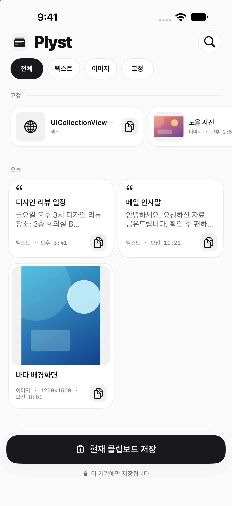
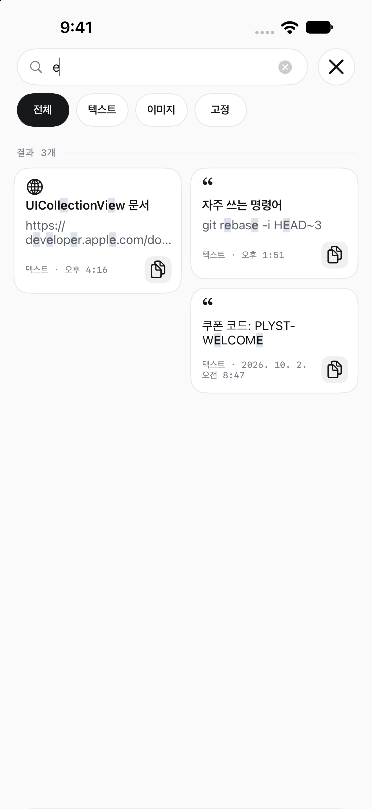
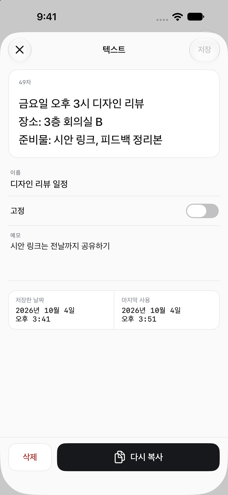
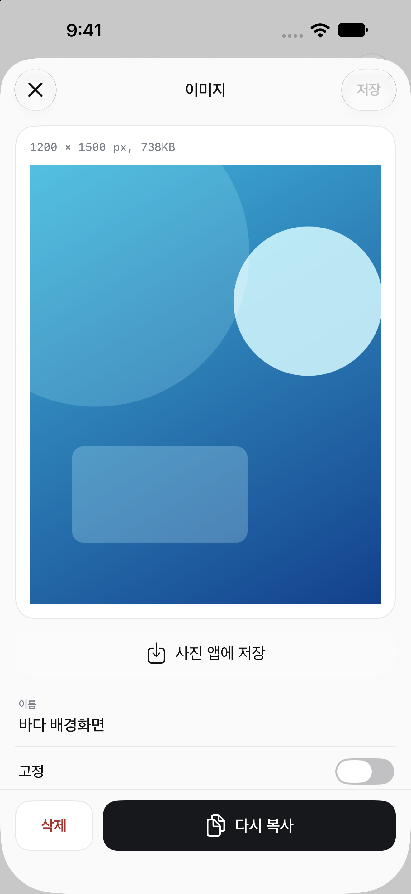
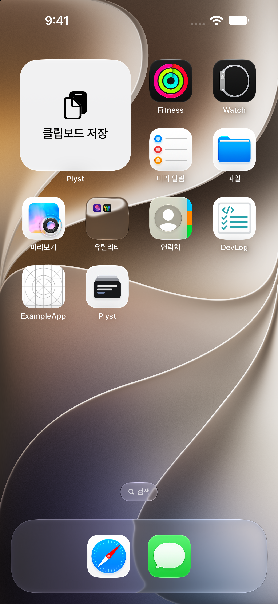
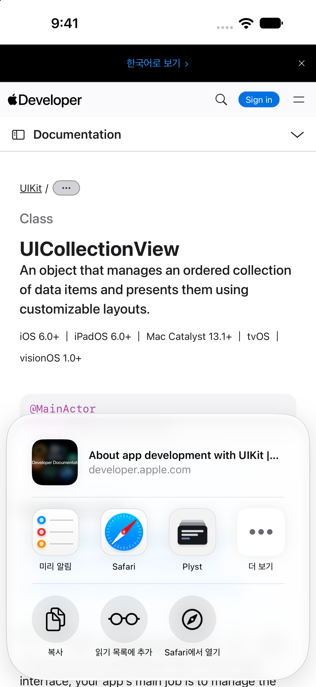
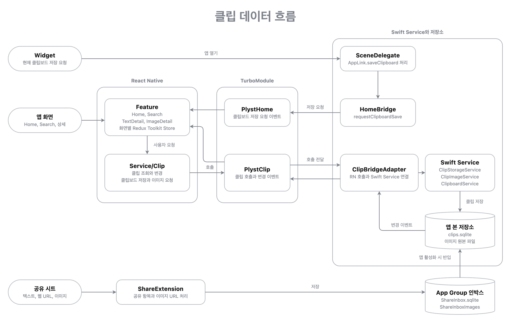

# Plyst RN

> 복사한 내용을 필요할 때 다시 꺼내 쓰는 iPhone 클립 보관함<br>
> Home과 Search에서 기록을 찾고 상세 화면에서 이름과 고정 여부를 관리하는 React Native 앱

[UIKit 구현 보기](https://github.com/opficdev/Plyst)

| Home | Search | 텍스트 상세 |
| :---: | :---: | :---: |
|  |  |  |

| 이미지 상세 | Widget | Share Extension |
| :---: | :---: | :---: |
|  |  |  |

## 프로젝트 개요

텍스트와 이미지를 클립으로 저장하고 종류와 고정 여부로 분류하며 검색한 내용을 다시 복사해 사용하는 앱

React Native가 앱 화면과 상태를 소유하고 Swift가 앱과 Scene 생명주기, React Native Runtime과 화면 호스트를 담당하는 구조<br>
Swift에서 TurboModule 구현, 클립보드와 사진 보관함, 이미지 파일과 SQLite 저장소 관리<br>
Share Extension의 공유 항목 저장과 Widget의 앱 열기도 Swift에서 처리



## 주요 기능

| 화면 | 기능 |
| --- | --- |
| Home | 전체, 텍스트, 이미지와 고정 필터<br>고정 클립 영역<br>현재 클립보드 저장 버튼<br>클립 복사와 길게 누르기 메뉴의 삭제, 고정 및 고정 해제<br>이미지 썸네일 비동기 로드<br>저장과 복사 결과 및 작업 실패 토스트 |
| Search | 이름과 텍스트 본문 검색<br>이미지 이름과 저장 시각 검색<br>이름과 텍스트 본문의 검색어 강조<br>최근 검색어 선택, 개별 삭제와 전체 삭제<br>전체, 텍스트, 이미지와 고정 필터 및 클립 복사 |
| 텍스트 상세 | 이름, 메모와 고정 여부 편집<br>저장, 복사와 삭제<br>저장 시각과 마지막 사용 시각 표시 |
| 이미지 상세 | 이미지 표시<br>이름과 고정 여부 편집<br>저장, 복사와 삭제<br>사진 앱 저장<br>저장 시각과 마지막 사용 시각 표시 |
| Widget | 앱을 열고 현재 클립보드 저장 요청 |
| Share Extension | 지원하는 첫 첨부의 텍스트, 웹 URL과 이미지 저장<br>이미지 URL 내려받기 및 내려받기나 이미지 검증 실패 시 URL을 텍스트로 저장<br>저장 실패 시 다시 시도와 취소 |

## 핵심 성과

### **1. Codegen TurboModule 단일 계약으로 RN 화면과 Swift 자원 계층 분리**
> **문제**<br>
> RN과 Swift가 호출 형식을 따로 정의하면 한쪽만 바뀌어도 호출이 어긋날 수 있음
>
> **해결**<br>
> PlystClip, PlystHome, PlystScreen의 Codegen 스펙을 RN과 Swift 구현 사이의 단일 계약으로 사용<br>
> RN 결과물과 브리지를 XCFramework로 묶어 PlystReactNative 패키지로 앱에 연결
>
> **성과**<br>
> • 데이터 호출과 이벤트 전달에 같은 Codegen 계약을 사용하는 구조

```swift
ReactNativeBrownfield.shared.bundle = ReactNativeBundle
ReactNativeBrownfield.shared.ensureExpoModulesProvider()
ReactNativeBrownfield.shared.startReactNative(
    launchOptions: launchOptions,
    preloadBundle: false,
    onBundleLoaded: nil
)
```

### **2. 썸네일 48개 제한과 요청 큐로 대용량 이미지 목록 처리**
> **문제**<br>
> 원본 해상도 디코딩과 화면 밖 요청 누적으로 표시 크기보다 많은 자원을 사용할 수 있음
>
> **해결**<br>
> FlashList의 masonry 배치에서 카드 너비와 화면 배율에 맞춘 ImageIO 썸네일 요청<br>
> 화면 밖 대기 요청을 제거하고 이미 실행 중인 요청은 완료 시 결과 폐기<br>
> 보이는 고정 클립의 썸네일 URI가 보관 목록에서 제거되면 다시 요청
>
> **성과**<br>
> • Home과 Search에서 각각 썸네일 URI 보관 수 48개와 요청 큐 동시 실행 수 2개로 제한<br>
> • 원본 파일을 유지하면서 화면에 표시할 축소본만 전달하는 구조

```swift
let thumbnailOptions = [
    kCGImageSourceCreateThumbnailFromImageAlways: true,
    kCGImageSourceCreateThumbnailWithTransform: true,
    kCGImageSourceShouldCacheImmediately: true,
    kCGImageSourceThumbnailMaxPixelSize: maximumPixelDimension
] as CFDictionary
```

### **3. 화면별 Redux Toolkit Store로 상태와 비동기 수명 관리**
> **문제**<br>
> 화면을 닫은 뒤 구독과 비동기 요청이 남으면 종료된 화면 상태를 갱신할 수 있음
>
> **해결**<br>
> 화면마다 Store를 만들고 createListenerMiddleware에서 Service 호출과 이벤트 구독 처리<br>
> reducer의 상태 변경과 Listener의 비동기 효과 분리<br>
> 화면 해제 시 Listener와 요청 큐 및 이벤트 구독 정리
>
> **성과**<br>
> • 종료된 세션의 화면 상태 갱신 없음<br>
> • 이미 시작한 저장과 복사의 결과 토스트는 별도 호스트에서 표시할 수 있음

```ts
const [screen] = useState(createHomeStore);
useLayoutEffect(() => {
  screen.start();
  return () => screen.dispose();
}, [screen]);
```

### **4. Inbox 반입 순서와 정리 후보 복구로 앱과 Extension 저장 무결성 유지**
> **문제**<br>
> 앱과 Share Extension이 서로 다른 프로세스에서 저장하므로 이미지 파일과 데이터베이스 쓰기가 한쪽만 완료될 수 있음
>
> **해결**<br>
> 앱의 clips.sqlite와 이미지 원본을 ShareInbox.sqlite 및 ShareInboxImages와 분리<br>
> 본 저장소에 확정한 클립만 Inbox에서 제거하고 저장소 쓰기 확정 뒤 변경 이벤트 전달<br>
> 이미지 파일의 pending 마커와 메타데이터 참조를 대조해 정리 후보 복구
>
> **성과**<br>
> • 반입 실패 항목은 Inbox에 남아 다시 처리되며 같은 식별자의 클립은 중복 추가되지 않음<br>
> • 참조 중인 파일은 정리 후보에서 해제되고 참조 없는 파일은 삭제됨

```swift
let copied = try await copy(clip, inboxImages: inboxImages)
// 집계와 복사 실패 처리 생략
try await remove(clip, inbox: inbox, inboxImages: inboxImages)
```

---

## 기술 스택

| 구분 | 스택 |
| --- | --- |
| 최소 지원 버전 | iOS 17.0+ |
| 지원 기기 | iPhone |
| 언어 | TypeScript 6.0.3, Swift 6.0 |
| 화면 | React Native 0.86.3, React 19.2.3, Expo 57.0.27, FlashList 2.3.3, expo-image 57.0.5, UIKit 호스트 |
| 앱 확장 | Share Extension, WidgetKit, SwiftUI |
| 상태 관리 | Redux Toolkit 2.13.0, React Redux 9.3.0 (RN 화면)<br>ReactorKit 3.2.0, RxSwift 6.10.2 (Share Extension 상태 관리) |
| 네이티브 계약 | TurboModule, Codegen |
| 앱 통합 | React Native Brownfield 5.3.0, XCFramework |
| 저장소 | SQLiteData 1.12.0, GRDB 7.11.1, swift-structured-queries 0.39.2 |
| Apple 프레임워크 | UIKit, Foundation, WidgetKit, SwiftUI, ImageIO, Photos |
| 테스트 | Jest 29.7.0, XCTest |
| 자동화 | GitHub Actions, fastlane |
